# SMART PURCHASE MODULE — SIMPLE USER SOP
**ZEETA ELECTRICAL ENGINEERING PVT. LTD.**  
*Document Version:* 3.0 (Production Master Release)  
*Effective Date:* October 2026  
*Target Audience:* Purchase Managers, Procurement Executives, Store Incharges, Department Heads (HODs), and System Administrators.

---

## 1. EXECUTIVE INTRODUCTION & PURPOSE

### 1.1 Enterprise Overview
The **Smart Purchase Module** is the core procurement management solution for **Zeeta Electrical Engineering Pvt. Ltd.** It manages the complete material lifecycle—from initial floor requisitions and commercial indents to Purchase Orders (PO), Goods Receipt Notes (GRN), store inventory updates, and live Google Sheets ERP integration.

### 1.2 User Roles & Responsibilities
* **Department Heads (HODs):** Initiate and approve material requisitions for production and maintenance.
* **Purchase Managers & Officers:** Review approved indents, create formal POs, negotiate rates, and track vendor delivery timelines.
* **Store Incharges:** Inspect incoming material at the factory gate, log physical GRNs, and credit inventory stock.
* **System Administrators:** Manage user access, configure roles, and monitor ERP data synchronization.

---

## 2. LOGIN & DIRECT AUTHENTICATION

### 2.1 Opening the Application
Access the Smart Purchase Module via any modern web browser at:
`http://172.16.18.22:8080/` (Production IP) or `http://localhost:8080/` (Workstation URL).

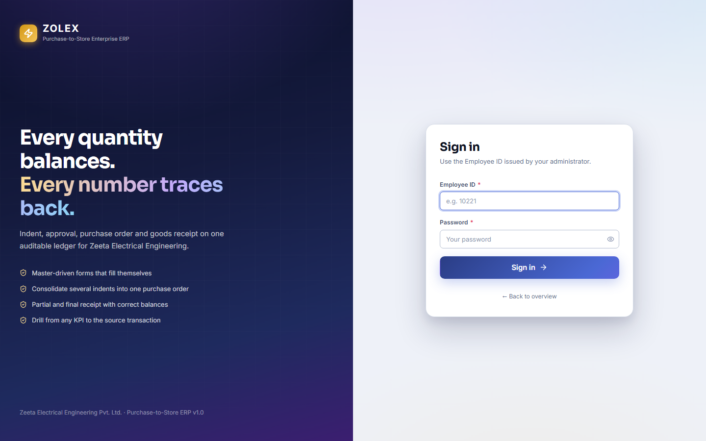

### 2.2 Direct Login Procedure
1. **[Callout ①] Employee ID:** Type your 5-digit Employee ID (e.g., `10221` for Admin, `20101` for Purchase Head).
2. **[Callout ②] Password:** Enter your secure password assigned by System Administration.
3. **[Callout ③] Sign In Button:** Click **Sign In** to log in.

> **Operational Standard:**  
> Sign-in connects users directly to the Purchase Dashboard — except the first time after an administrator has set the password (a new account or a password reset). Then a **Set a new password** screen appears first: enter a new password of your own (at least 8 characters with upper and lower case, a digit and a symbol, not containing your Employee ID) and confirm it. Nothing else opens until you do; afterwards you continue straight to the page you asked for.

---

## 3. PURCHASE MODULE DASHBOARD

After sign-in, users land directly on the **Purchase Overview Dashboard**.

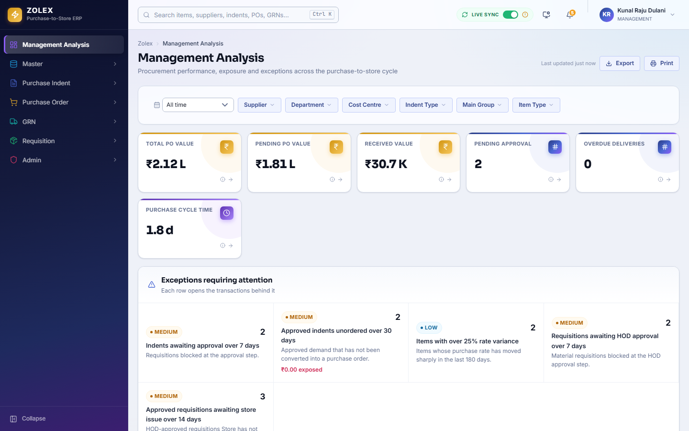

### 3.1 Dashboard Layout & Metrics
* **[Callout ①] Total Requisitions:** Active material requests awaiting review.
* **[Callout ②] Active Indents:** Approved indents ready for PO creation.
* **[Callout ③] Pending Orders:** POs dispatched to suppliers awaiting delivery.
* **[Callout ④] Completed GRNs:** Goods received into stock for the current period.
* **[Callout ⑤] Navigation Shell:** Sidebar menu for switching between module sections.

---

## 4. USER ADMINISTRATION & MANAGEMENT

System Administrators can add new employees and assign roles directly. The first password an administrator sets (for a new account, or with **Reset password**) must be replaced by the employee at their next sign-in unless the administrator unticks **Must change this password**. Give every person their own password — never an example or a shared one; the system refuses published passwords and passwords that contain the Employee ID. Only a Super Admin can reset, edit or deactivate another Super Admin.

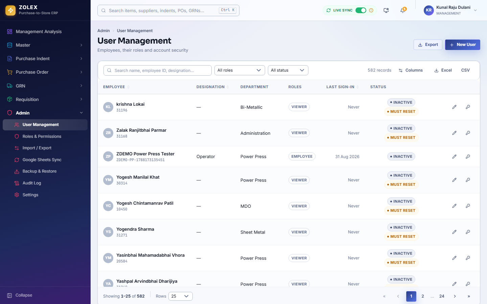

### 4.1 Creating a New User
1. Open **Admin > Users** from the left navigation menu.
2. Click **+ New User** `[Callout ①]`.

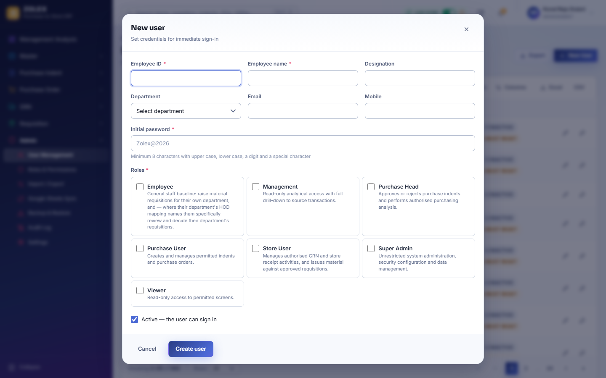

3. Fill out the mandatory fields:
   * **[Callout ①] Employee ID:** Unique numeric ID (e.g., `test_purchase_user`).
   * **[Callout ②] Employee Name:** Full employee name.
   * **[Callout ③] Designation:** Job title (e.g., `Purchase Officer`).
   * **[Callout ④] Password:** Initial login credentials.
   * **[Callout ⑤] Role Assignment:** Select appropriate roles (`Purchase Officer`, `Purchase Head`).
4. Click **Create user** `[Callout ⑥]`. The account is saved and ready for direct sign-in.

---

## 5. PURCHASE REQUISITION WORKFLOW

Material requests originate as **Purchase Requisitions** created by floor operators or HODs.

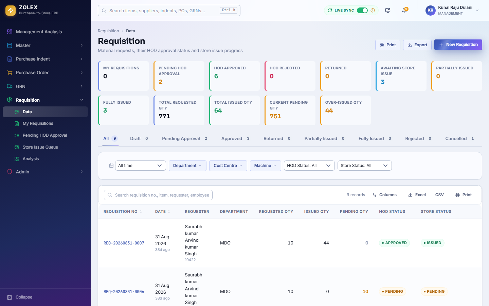

### 5.1 Creating a Requisition
1. Click **Requisitions** on the sidebar.
2. Click **+ New Requisition** `[Callout ①]`.

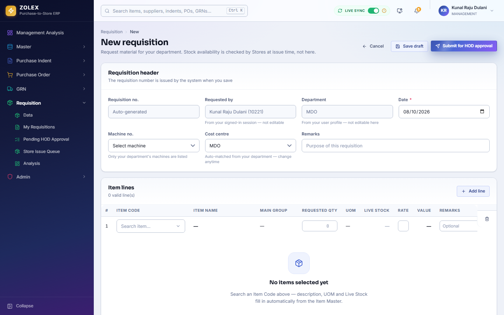

3. Enter requirement details:
   * **[Callout ①] Department:** Target shopfloor department (e.g., Fabrication, Assembly).
   * **[Callout ②] Item Selection:** Choose catalog item code or description.
   * **[Callout ③] Quantity & UOM:** Enter required quantity and unit (KGs, Pcs, Meters).
   * **[Callout ④] Required Date:** Select target floor delivery date.
   * **[Callout ⑤] Remarks:** Add technical specs or project tags.
4. Click **Submit Requisition** `[Callout ⑥]`. Status moves to **HOD Review**.

---

## 6. PURCHASE INDENT WORKFLOW

Approved requisitions are consolidated into commercial **Purchase Indents** for purchasing.

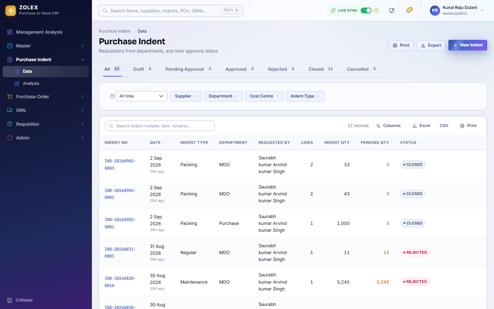

### 6.1 Raising an Indent
1. Click **Indents** on the navigation menu.
2. Click **+ New Indent** `[Callout ①]`.

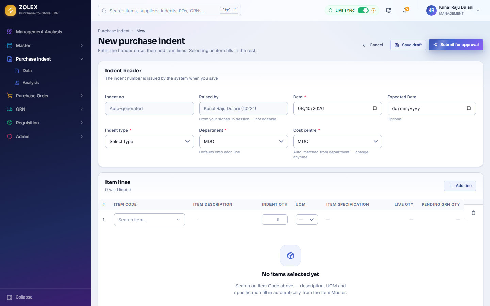

3. Fill out Indent details:
   * **[Callout ①] Indent Category:** Raw Material, Standard Component, Tooling, or Consumable.
   * **[Callout ②] Linked Requisition:** Select from pending approved requisitions.
   * **[Callout ③] Verified Quantity:** Confirm technical specs and quantity.
   * **[Callout ④] Cost Centre:** Assign accounting project head.
4. Click **Save & Submit Indent** `[Callout ⑤]`.

---

## 7. PURCHASE ORDER (PO) WORKFLOW

A **Purchase Order (PO)** is issued to certified suppliers containing agreed rates, tax terms, and delivery schedules.


### 7.1 Generating a Purchase Order
1. Navigate to **Orders** on the sidebar.
2. Click **+ New Order** `[Callout ①]`.
3. Select Supplier, link approved Indent, set Unit Rate, GST %, Payment Terms, and Delivery Date.
4. Click **Generate PO**. The PO is issued with a unique PO number (e.g., `PO-2026-0042`).

---

## 8. GOODS RECEIPT NOTE (GRN) WORKFLOW

When material arrives at the factory gate, the Store Incharge logs a **Goods Receipt Note (GRN)**.

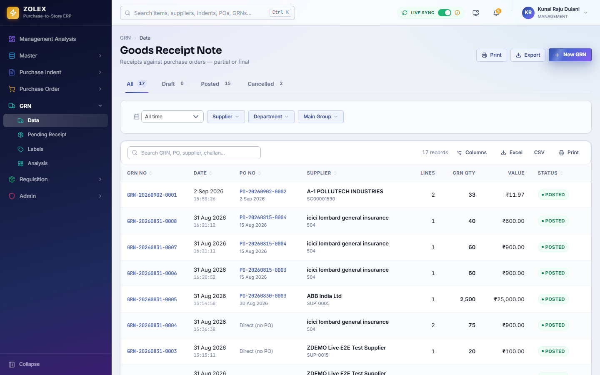

### 8.1 Logging a Goods Receipt
1. Open **GRN** on the sidebar.
2. Click **+ New GRN** `[Callout ①]`.

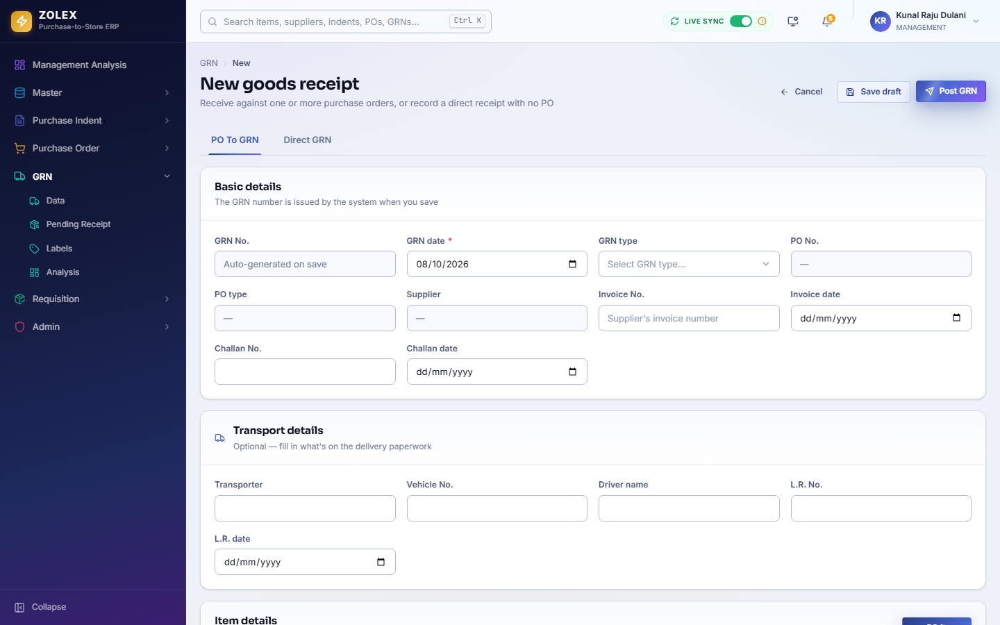

3. Complete receipt entry:
   * **[Callout ①] Purchase Order:** Select matching active PO.
   * **[Callout ②] Vendor Invoice No:** Log supplier invoice number and date.
   * **[Callout ③] Logistics Details:** Enter transporter and vehicle registration.
   * **[Callout ④] Received Quantity:** Record physically weighed / counted quantity.
   * **[Callout ⑤] Accepted vs Rejected:** Record passed items vs QC-rejected items.
4. Click **Submit GRN** `[Callout ⑥]`. Stock is automatically credited to inventory.

---

## 9. INVENTORY STOCK & ITEM MASTER

The **Items & Inventory** section provides real-time visibility into raw material stock and component balances.


### 9.1 Store Features
* **[Callout ①] Search & Filter:** Search by CAT No, Zeeta Code, or Item Description.
* **[Callout ②] Stock Balance:** Live physical quantity on hand.
* **[Callout ③] Reorder Point:** Alerts for items below safety stock.

---

## 10. GOOGLE SHEETS ERP DATA SYNC

Bi-directional synchronization updates master Google Sheets ERP documents.

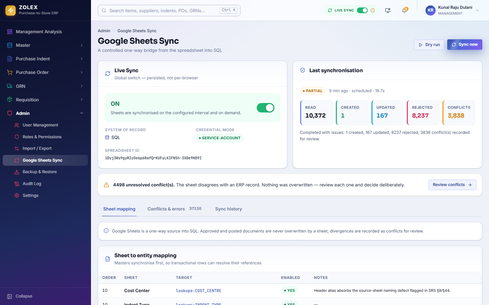

### 10.1 Running Data Sync
1. Open **Admin > Data Sync**.
2. Click **Sync Now** `[Callout ①]` to refresh master items, PO balances, and GRN receipts.

---

## 11. REPORTS & PURCHASE ANALYTICS

Analytics provide operational insights into vendor performance and spend.

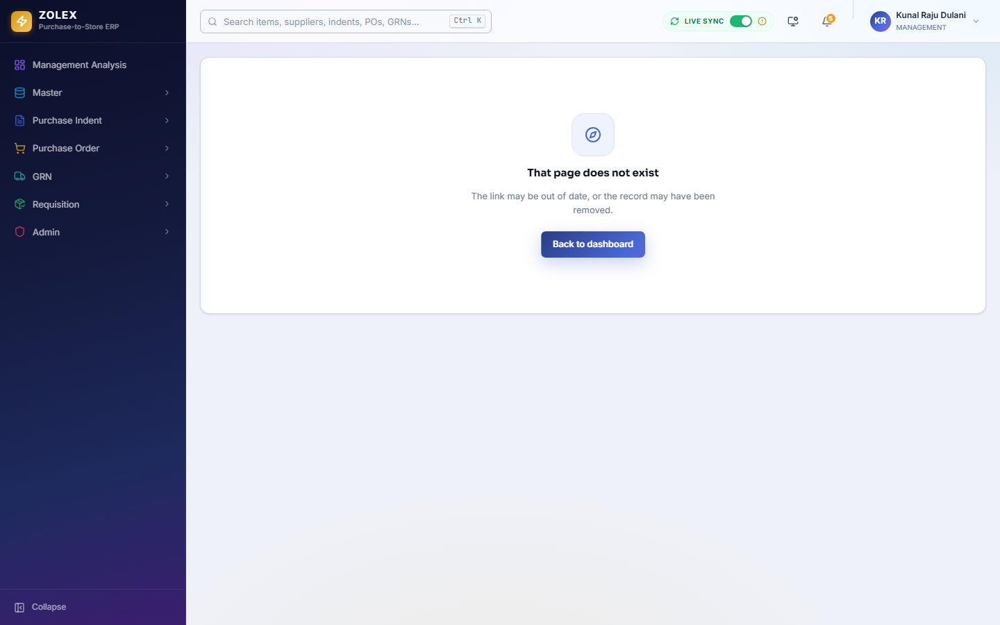

---

## 12. USER PROFILE & VOLUNTARY PASSWORD CHANGE

Users can view profile details and update passwords voluntarily from settings. (A password set by an administrator must be changed at the next sign-in — see section 2.)

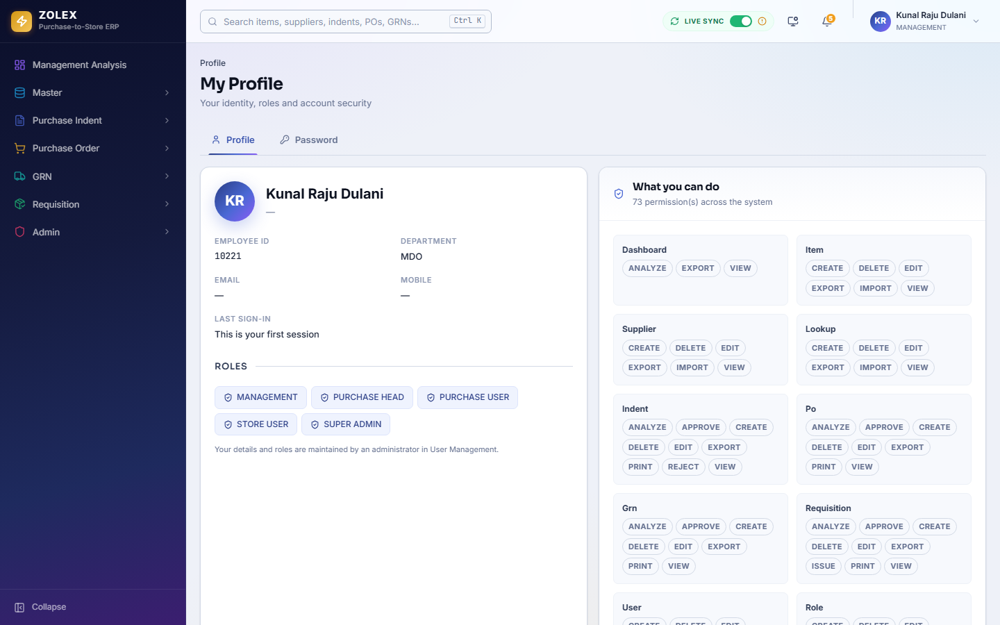

---

## 13. COMPLETE VISUAL WORKFLOW DIAGRAM

```
+-------------------------------------------------------------------+
|                        PURCHASE REQUISITION                       |
|   Raised by Department / Floor Operator for raw material / items  |
+-------------------------------------------------------------------+
                                  |
                                  v
+-------------------------------------------------------------------+
|                           HOD APPROVAL                            |
|        Department Head reviews quantity and floor requirement     |
+-------------------------------------------------------------------+
                                  |
                                  v
+-------------------------------------------------------------------+
|                         PURCHASE INDENT                           |
|       Consolidated commercial request created by Purchase Team    |
+-------------------------------------------------------------------+
                                  |
                                  v
+-------------------------------------------------------------------+
|                          PURCHASE ORDER                           |
|      Formal PO issued to supplier with agreed rate, GST & terms   |
+-------------------------------------------------------------------+
                                  |
                                  v
+-------------------------------------------------------------------+
|                       GOODS RECEIPT NOTE (GRN)                    |
|    Material arrives at factory; Store verifies physical quantity  |
+-------------------------------------------------------------------+
                                  |
                                  v
+-------------------------------------------------------------------+
|                       STOCK & ERP SYNC UPDATED                    |
| Inventory credited; Google Sheets ERP synchronized in real time   |
+-------------------------------------------------------------------+
```

---

## 14. EMPLOYEE TROUBLESHOOTING GUIDE

| Issue / Error | Probable Cause | Action Required |
| :--- | :--- | :--- |
| **Invalid Employee ID or password.** | Credentials mistyped. | Re-verify credentials. Contact Admin for reset if needed. |
| **Access Denied / Unauthorized** | Missing role permissions. | Contact Administrator to assign required role. |
| **GRN Quantity Exceeds PO Limit** | Over-delivery by vendor. | Adjust GRN quantity or amend PO limit before submitting. |
| **Google Sync Timeout** | Temporary network disruption. | Click **Sync Now** again on the Data Sync panel. |

---

## 15. SCREENSHOT PROOF REGISTER

| Fig No | Filename | Live Application URL | SOP Purpose | Verification Status |
| :---: | :--- | :--- | :--- | :---: |
| 1 | `purchase_01_login.png` | `http://localhost:8080/login` | Direct Login Screen | **VERIFIED LIVE** |
| 2 | `purchase_02_dashboard.png` | `http://localhost:8080/dashboard` | Main Purchase Dashboard | **VERIFIED LIVE** |
| 3 | `purchase_03_user_management.png` | `http://localhost:8080/admin/users` | User Administration Panel | **VERIFIED LIVE** |
| 4 | `purchase_04_create_user.png` | `http://localhost:8080/admin/users` | New User Creation Form | **VERIFIED LIVE** |
| 5 | `purchase_05_requisition_list.png` | `http://localhost:8080/requisitions` | Purchase Requisitions Register | **VERIFIED LIVE** |
| 6 | `purchase_06_create_requisition.png` | `http://localhost:8080/requisitions` | Create Requisition Modal | **VERIFIED LIVE** |
| 7 | `purchase_07_indent_list.png` | `http://localhost:8080/indents` | Purchase Indents Register | **VERIFIED LIVE** |
| 8 | `purchase_08_create_indent.png` | `http://localhost:8080/indents` | Create Indent Entry Form | **VERIFIED LIVE** |
| 9 | `purchase_11_po_list.png` | `http://localhost:8080/orders` | Purchase Orders Master View | **VERIFIED LIVE** |
| 10 | `purchase_14_grn_list.png` | `http://localhost:8080/grn` | Goods Receipt Notes Register | **VERIFIED LIVE** |
| 11 | `purchase_15_create_grn.png` | `http://localhost:8080/grn` | Goods Receipt Entry Modal | **VERIFIED LIVE** |
| 12 | `purchase_16_stock.png` | `http://localhost:8080/items` | Item Catalog & Store Inventory | **VERIFIED LIVE** |
| 13 | `purchase_17_google_sync.png` | `http://localhost:8080/admin/sync` | Google Sheets ERP Sync | **VERIFIED LIVE** |
| 14 | `purchase_18_reports.png` | `http://localhost:8080/reports` | Analytics & Spending Reports | **VERIFIED LIVE** |
| 15 | `purchase_19_profile.png` | `http://localhost:8080/profile` | Voluntary Password & Profile | **VERIFIED LIVE** |

---
*End of Smart Purchase Module Simple User SOP — Zeeta Electrical Engineering Pvt. Ltd.*
